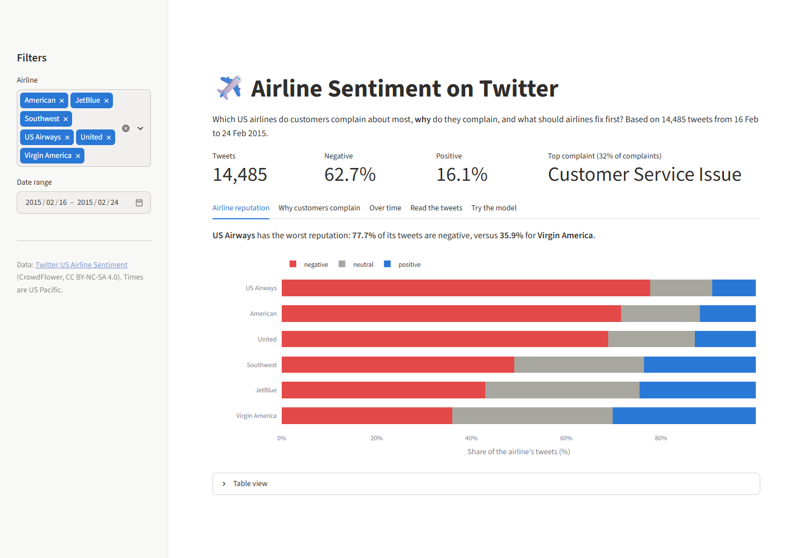
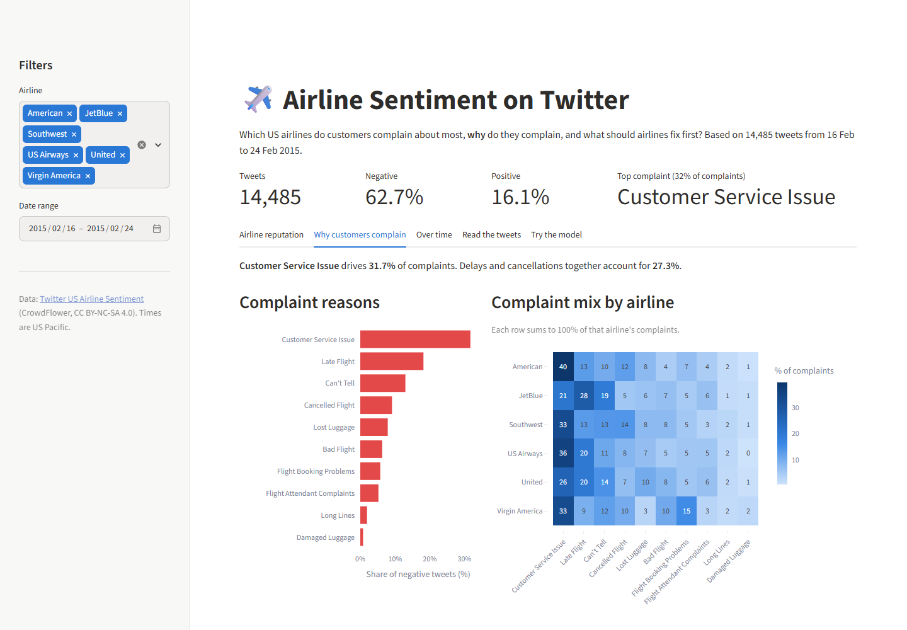
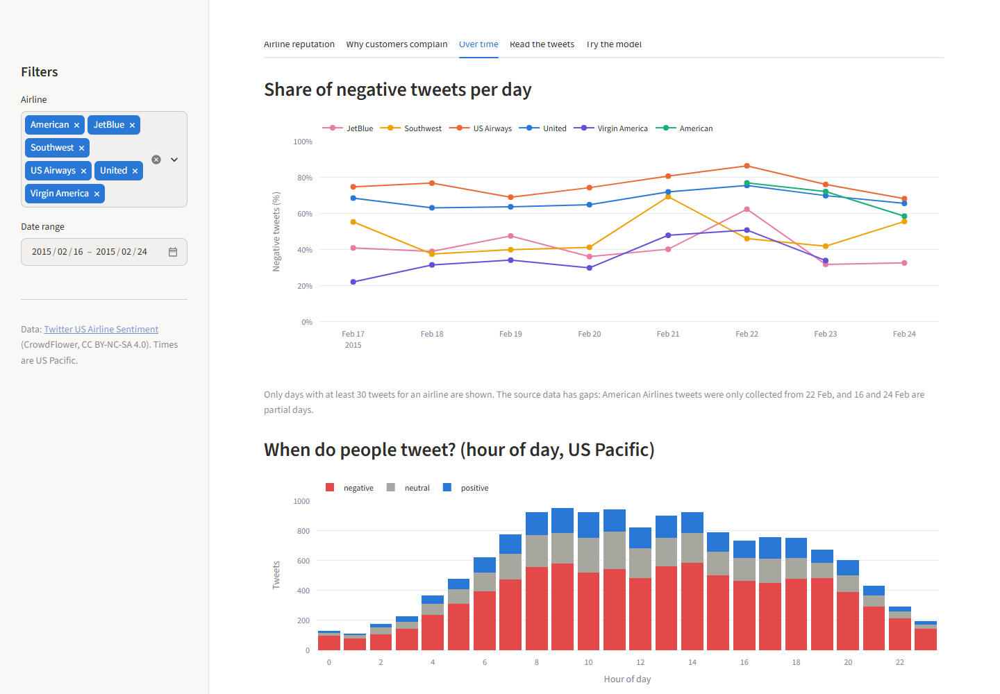

# ✈️ Airline Sentiment on Twitter

**🔗 Live dashboard: [airline-sentiment-antarez.streamlit.app](https://airline-sentiment-antarez.streamlit.app)**

Analysis of 14,485 customer tweets about six US airlines to find out **which airlines customers complain about most, why they complain, and what airlines should fix first**.



## 🎯 Business Problem

Twitter is where airline customers complain in public. A Customer Experience / Social Care team has limited people, so it needs to know where to focus. This project answers four questions:

1. How negative is public conversation about airlines?
2. Which airlines have the worst and best reputation on Twitter?
3. What drives customer complaints: operations (delays, cancellations) or customer service?
4. What should the Customer Experience team prioritize?

## 📌 Key Insights

| # | Insight |
|---|---|
| 1 | **62.7%** of tweets are negative and only 16.1% are positive. Customers use Twitter mainly to complain. |
| 2 | **US Airways** has the worst reputation (**77.7%** negative), followed by American (71.6%) and United (68.9%). **Virgin America** has the best (35.9% negative). |
| 3 | United, US Airways and American produce 64% of tweet volume but **74% of all negative tweets**. |
| 4 | **Customer service** is the #1 complaint driver (**31.7%** of negative tweets), bigger than late and cancelled flights combined (27.3%). |
| 5 | **Cancellations drive the spikes.** On the weekend of 21–22 Feb, **70.0%** of tweets were negative (56.6% on other days) as cancellation complaints jumped from 6.9% to 11.2%. **Evenings are the most negative** time of day (67.8% after 18:00). |

## 💡 Recommendations

1. **Fix customer service before punctuality.** It is the biggest complaint driver and the one airlines control most directly (staff training, response time, empowering agents to resolve issues).
2. **Focus social care resources on United, US Airways and American**, which together generate three quarters of negative tweets.
3. **Notify passengers proactively about delays and cancellations**, with automatic rebooking options, so operational problems do not escalate into service complaints.
4. **Benchmark against Virgin America**, whose share of positive tweets (30.2%) is over 3× that of US Airways (9.2%).
5. **Monitor sentiment automatically.** The classification model in this project flags negative tweets so the social care team does not have to read every tweet manually.
6. **Staff social care for disruptions and evenings.** Add capacity on days with mass cancellations and keep coverage into the evening. Answer vague complaints ("worst airline ever") by asking for details in a private message.

## 📊 Dashboard

The [live dashboard](https://airline-sentiment-antarez.streamlit.app) lets you filter by airline and date, and has five views:

| View | Answers |
|---|---|
| **Airline reputation** | Which airlines have the highest share of negative tweets? |
| **Why customers complain** | Which complaint reasons dominate, overall and per airline? |
| **Over time** | Does negativity change by day, and when do people tweet? |
| **Read the tweets** | What are customers actually saying? Search by keyword, sentiment and reason. |
| **Try the model** | Type a tweet and see how the model classifies it. |





## 🗄️ SQL Analysis

The business questions are also answered in SQL ([DuckDB](https://duckdb.org)), one query per question in [`sql/`](sql/), with results and findings in [`notebooks/02_sql_analysis.ipynb`](notebooks/02_sql_analysis.ipynb). What SQL added on top of the dashboard:

- **Customer service at just two airlines, US Airways and American, accounts for 19.7% of all actionable complaints.** Customer Service Issue is the #1 complaint at 5 of 6 airlines; only JetBlue's #1 is late flights (35.0% of its complaints, 1.67× the rate at other airlines).
- **Negativity peaked on the weekend of 21–22 Feb.** 22 Feb was the worst day of the week for United (75.7% negative), US Airways (86.6%), JetBlue (62.5%) and Virgin America (50.9%), and Southwest peaked on 21 Feb (69.5%).
- **All 155 duplicate rows in the raw data belong to American**, and 18 of those tweets carry conflicting sentiment labels.

Example: the #1 and #2 complaint for each airline ([`sql/04_top_reason_per_airline.sql`](sql/04_top_reason_per_airline.sql)).

```sql
WITH counts AS (
    SELECT airline, negative_reason AS reason, COUNT(*) AS complaints
    FROM read_csv_auto('data/processed/dashboard_data.csv')
    WHERE sentiment = 'negative' AND negative_reason <> 'Can''t Tell'
    GROUP BY airline, negative_reason
),
ranked AS (
    SELECT *,
           ROW_NUMBER() OVER (PARTITION BY airline ORDER BY complaints DESC, reason) AS reason_rank,
           ROUND(100.0 * complaints / SUM(complaints) OVER (PARTITION BY airline), 1) AS share_of_airline_pct
    FROM counts
)
SELECT airline, reason_rank, reason, complaints, share_of_airline_pct
FROM ranked
WHERE reason_rank <= 2
ORDER BY airline, reason_rank;
```

Run any query from the project root with `python scripts/run_sql.py sql/<file>.sql` (needs `requirements-dev.txt`).

## 🔍 Approach

1. **Data cleaning** ([`src/data.py`](src/data.py))
   - Found and removed 155 duplicate tweets, keeping the label with the highest annotator confidence.
   - Found that 99.8% of tweets labeled "Delta" in the source are addressed to @JetBlue, so they are relabeled as JetBlue.
   - Found that the source had replaced every *cancel*, *late* and *booking* in the tweet text with a complaint label ("Cancelled Flightled"), and restored the original words.
   - Converted timestamps to US Pacific time and fixed HTML entities in the text.
2. **Exploratory analysis** ([`notebooks/01_eda.ipynb`](notebooks/01_eda.ipynb)): sentiment by airline, complaint reasons, tweet length and timing, answered against the four business questions.
3. **SQL analysis** ([`sql/`](sql/), [`notebooks/02_sql_analysis.ipynb`](notebooks/02_sql_analysis.ipynb)): six DuckDB queries using CTEs and window functions, tested against the dashboard numbers.
4. **Sentiment classification** ([`notebooks/03_sentiment_model.ipynb`](notebooks/03_sentiment_model.ipynb)): compared four approaches on 2,893 held-out tweets. Duplicates are removed before the train-test split, so the same tweet cannot appear in both sets, and contractions are expanded (*didn't* → *did not*) so negations survive stopword removal.

   | Model | Accuracy | F1 negative | F1 neutral | F1 positive |
   |---|---|---|---|---|
   | **Logistic Regression (TF-IDF)** | **77.7%** | 0.85 | 0.61 | 0.73 |
   | Naive Bayes (TF-IDF) | 74.7% | 0.84 | 0.39 | 0.60 |
   | DistilBERT (pre-trained, no fine-tuning) | 70.9% | 0.84 | 0.06 | 0.65 |
   | VADER (rule-based) | 55.4% | 0.65 | 0.42 | 0.50 |

   Logistic Regression is the most accurate single model, fast and explainable, so it powers the dashboard's model tab. A majority vote of the models scored about 2 points higher on the test set; confirming that with cross-validation is a possible next step.
5. **Dashboard** ([`app/streamlit_app.py`](app/streamlit_app.py)): the chart metrics live in [`src/metrics.py`](src/metrics.py) and are covered by unit tests in [`tests/`](tests/).

> **Limitations:** the data covers about one week in February 2015, Twitter users skew toward customers who had a problem, and nearly all American Airlines tweets (2,600 of 2,604) are from 22 Feb onward. 13% of complaints are labeled "Can't Tell", so the reason shares describe the complaints that annotators could classify.

## 🛠️ Tech Stack

- **Analysis:** SQL (DuckDB), Python, pandas, Jupyter
- **Visualization:** Plotly, Matplotlib, Seaborn, WordCloud
- **NLP / ML:** scikit-learn (TF-IDF, Logistic Regression, Naive Bayes), NLTK, VADER, HuggingFace Transformers
- **Dashboard:** Streamlit, deployed on Streamlit Community Cloud
- **Testing:** pytest

## 📁 Project Structure

```
sentiment-analysis-dashboard/
├── app/streamlit_app.py           # Streamlit dashboard
├── data/
│   ├── raw/                       # Tweets.csv goes here (not committed)
│   └── processed/                 # Cleaned dashboard data
├── docs/images/                   # README screenshots
├── models/                        # TF-IDF vectorizer and Logistic Regression used by the dashboard
├── notebooks/
│   ├── 01_eda.ipynb               # Business questions, EDA and insights
│   ├── 02_sql_analysis.ipynb      # Business questions answered in SQL
│   └── 03_sentiment_model.ipynb   # VADER, Naive Bayes, Logistic Regression, DistilBERT compared
├── scripts/
│   ├── build_dashboard_data.py    # Raw CSV → cleaned dashboard data
│   └── run_sql.py                 # Run a query from sql/ and print the result
├── sql/                           # One DuckDB query per business question
├── src/
│   ├── data.py                    # Cleaning and loading
│   ├── metrics.py                 # Aggregations behind each chart
│   ├── predict.py                 # Text cleaning and model prediction
│   └── sql.py                     # Runs the queries in sql/
├── tests/                         # Dashboard metrics and SQL-vs-pandas checks
├── requirements.txt               # Dashboard dependencies
└── requirements-dev.txt           # + notebook and test dependencies
```

## 🚀 Run Locally

Requires Python 3.11+.

```bash
git clone https://github.com/antarezQ/sentiment-analysis-dashboard.git
cd sentiment-analysis-dashboard
python -m venv .venv
source .venv/bin/activate      # Windows: .venv\Scripts\activate
pip install -r requirements.txt
streamlit run app/streamlit_app.py
```

The cleaned dashboard data is already in the repo. To rebuild it from the raw data, put `Tweets.csv` in `data/raw/` and run `python scripts/build_dashboard_data.py`. To rerun the notebooks and tests, install `requirements-dev.txt` and run `pytest`.

## 📂 Dataset

[Twitter US Airline Sentiment](https://www.kaggle.com/datasets/crowdflower/twitter-airline-sentiment) (Kaggle / CrowdFlower, CC BY-NC-SA 4.0): 14,640 tweets from February 2015, each labeled positive, neutral or negative by human annotators, with a complaint reason for negative tweets. The raw file is not committed to this repo.

## 👤 Author

**Muhammad Antarez Qhadafi** · [LinkedIn](https://www.linkedin.com/in/antarezq/) · [GitHub](https://github.com/antarezQ)
